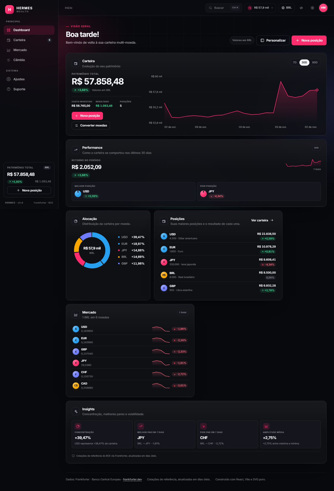

# Hermes · Câmbio e carteira multi-moeda

SPA em **React 19 + Vite 7** para consultar cotações de referência do **Banco Central Europeu** (via [Frankfurter](https://frankfurter.dev)), converter moedas, analisar séries históricas e gerir uma carteira multi-moeda com **entradas e saídas**. Interface em **PT-BR, EN e ES**, temas claro/escuro e persistência local — sem backend, login ou chave de API.

> **Entrega:** aplicação funcional, documentação, coleção Postman e histórico Git.
>
> - Repositório: <https://github.com/wesleymiguelweb/AppExchange>
> - Postman: <https://wesleymiguelweb-875969.postman.co/workspace/Wesley-Miguel's-Workspace~f4ff9240-77cc-4676-87d3-bac294e4d5eb/request/55256985-17534e58-cb0e-49a6-a6df-b1d83f3ad07b?sideView=agentMode>
> - Coleção versionada: [`postman/Hermes-Frankfurter.postman_collection.json`](postman/Hermes-Frankfurter.postman_collection.json)



---

## 1. O que a aplicação entrega

| Área | Funcionalidades |
| --- | --- |
| **Dashboard** | Patrimônio, custo investido, resultado, evolução da carteira em 7/30/90 dias, performance, alocação, posições, watchlist, insights e personalização de painéis (visibilidade, tamanho, ordem e arraste). |
| **Carteira** | Posições derivadas do histórico, quantidade, custo médio ponderado em BRL, valor de mercado, resultado, peso, busca, ordenação, paginação, exportação CSV e histórico completo de **entradas e saídas**. |
| **Movimentações** | Registro de entrada ou saída com moeda, quantidade, data, preço por unidade (cotação de hoje ou manual) e custos. Várias entradas na mesma moeda em preços diferentes; saídas com validação de saldo. |
| **Mercado** | Navegador de moedas com busca sem acento, ordenação, visão em cartões/lista, variação em 7 dias, sparklines e detalhe do ativo com série de 30 dias. |
| **Câmbio** | Conversor com validação e troca de moedas, oito períodos históricos, gráfico SVG com tooltip/teclado, resumo estatístico, tabela de cotações e CSV. |
| **Ajustes** | Tema, idioma, fonte, moeda base, restauração/limpeza da carteira e controle dos painéis do dashboard. |
| **Suporte** | FAQ, atalhos, mapa da interface e origem dos dados. |
| **Transversal** | Busca global (`Ctrl+K` ou `/`), modais acessíveis, toasts, estados de carregamento/erro/vazio, tema claro/escuro e layout responsivo. |

Não há login, backend próprio, banco de dados remoto, chave de API ou UI kit externo.

---

## 2. Stack e decisões

| Escolha | Por quê |
| --- | --- |
| **React 19 + Vite 7** | Requisito do trabalho; dev server rápido, build otimizado e JSX moderno. |
| **JavaScript + JSX (sem TypeScript)** | Mantém o foco nos fundamentos pedidos: componentes, props, estado, efeitos e hooks. |
| **CSS Modules + Tailwind v4 incremental** | CSS Modules preserva o controle dos tokens HERMES; utilitários Tailwind aceleram menus e overlays novos. A ordem das camadas é declarada em `src/styles/tailwind.css` (`project → theme → base → utilities`), o que evita a regressão em que utilitários perdiam para o fallback `@layer properties`. |
| **SVG puro para gráficos** | Nenhuma biblioteca de charting: eixos, escala, crosshair, tooltip, teclado e sparklines ficam explícitos no código. |
| **`prop-types`** | Validação leve de props em desenvolvimento, sem custo relevante no bundle. |
| **`Intl` nativo** | Números, moedas, percentuais e datas por locale; `Intl.DisplayNames` resolve nomes de moedas. |
| **Dicionário próprio de i18n** | Três idiomas, interpolação e troca em runtime sem dependências. |
| **`localStorage` versionado** | Carteira, preferências, tema, fonte, idioma e layout ficam no navegador, com migração de modelos antigos. |

---

## 3. Como executar

Requisitos: **Node.js 20.19+** (ou 22.12+) e npm.

```bash
npm install
npm run dev
```

Abra o endereço exibido pelo Vite (por padrão `http://localhost:5173`).

```bash
npm run build     # build de produção em dist/
npm run preview   # serve o build localmente
```

> Windows: se o PowerShell bloquear `npm.ps1`, use `npm.cmd` nos mesmos comandos.

---

## 4. Estrutura

```
AppExchange/
├── docs/
│   ├── CHECKLIST.md          # requisitos → evidência no código
│   ├── COMMITS.md            # histórico Git e publicação
│   ├── EVIDENCE.md           # trechos de código e capturas
│   ├── PROTOTIPO.md          # leitura do design guide e adaptações
│   ├── QA.md                 # matriz de testes executados
│   └── evidence/             # capturas desktop, tablet, mobile, RIA
├── postman/
│   └── Hermes-Frankfurter.postman_collection.json
├── public/favicon.svg
├── src/
│   ├── components/
│   │   ├── chart/            # ChartCard, PeriodTabs, RateChart, PeriodSummary
│   │   ├── converter/        # ConverterCard, CurrencySelect
│   │   ├── layout/           # AppShell, Header, menus, PageHeader
│   │   ├── overlays/         # PositionModal, AssetDetailModal, SearchPalette
│   │   ├── portfolio/        # EntriesTable
│   │   ├── rates/            # RatesCard, RatesTable, TableToolbar
│   │   └── ui/               # Button, Card, Field, Icon, Modal, charts…
│   ├── constants/            # rotas, períodos, painéis e fontes
│   ├── context/              # MarketData, Portfolio, Panels, Toast e UIContext
│   ├── hooks/                # dados, histórico, localStorage, tema, fonte…
│   ├── i18n/                 # provider, hook e dicionários PT/EN/ES
│   ├── services/             # http.js e frankfurterApi.js
│   ├── styles/               # tokens, global, tailwind e fontes
│   ├── utils/                # entries, portfolio, csv, dates, format…
│   ├── views/                # Dashboard, Portfolio, Markets, Trade, Settings, Support
│   ├── App.jsx               # composição, rotas e modais globais
│   └── main.jsx
├── index.html
├── package.json
└── vite.config.js
```

Pontos de leitura recomendados:

1. `src/context/PortfolioContext.jsx` — modelo de movimentações, migração e CRUD.
2. `src/utils/entries.js` — preço em BRL, custo médio e agregações.
3. `src/views/PortfolioView.jsx` — posições, histórico, filtros e CSV.
4. `src/components/overlays/PositionModal.jsx` — formulário de entrada/saída.
5. `src/services/frankfurterApi.js` — contrato com a API.
6. `src/components/chart/RateChart.jsx` — gráfico, interação e acessibilidade.

---

## 5. Modelo da carteira

Cada moeda guarda um **histórico de movimentações**, não um saldo editável:

```js
{
  id: 'pos-usd-…',
  code: 'USD',
  entries: [
    {
      id: 'ent-…',
      type: 'in',          // 'in' = entrada | 'out' = saída
      quantity: 1000,
      price: 5.15,         // BRL por unidade
      priceSource: 'manual', // 'manual' | 'market'
      fee: 0,              // BRL
      date: '2026-10-30',
      createdAt: '2026-10-30T12:00:00.000Z'
    }
  ]
}
```

- A **quantidade** e o **custo médio** são derivados por `summarizeEntries`.
- Entradas somam quantidade e custo (`quantidade × preço + taxa`).
- Saídas reduzem a quantidade pelo custo médio das unidades restantes; a taxa é descontada do valor resgatado.
- Várias entradas na mesma moeda, em datas e preços diferentes, são permitidas e aparecem individualmente no histórico.
- O preço é sempre gravado em **BRL por unidade**, independentemente da moeda base. Trocar a base não corrompe o histórico.
- Se o preço for deixado em branco, a cotação do dia é capturada no momento do registro (`priceSource: 'market'`).
- Moedas com saldo zero saem da carteira ativa, mas o histórico permanece disponível no detalhe do ativo até ser removido.
- Chaves: `hermes.portfolio.v3` (atual). A aplicação migra automaticamente `v2` (compra/venda) e `v1` (quantidade + custo médio).

---

## 6. Consumo da API

Base: `https://api.frankfurter.dev/v1` — pública, **sem chave**.

| Uso | Endpoint | Exemplo |
| --- | --- | --- |
| Lista de moedas | `GET /currencies` | `https://api.frankfurter.dev/v1/currencies` |
| Últimas taxas por base | `GET /latest?base={BASE}` | `https://api.frankfurter.dev/v1/latest?base=BRL` |
| Série histórica | `GET /{start}..{end}?base={BASE}&symbols={QUOTE}` | `https://api.frankfurter.dev/v1/2026-10-04..2026-11-03?base=BRL&symbols=USD` |

Exemplo de `/latest`:

```json
{
  "amount": 1.0,
  "base": "BRL",
  "date": "2026-11-03",
  "rates": {
    "AUD": 0.2831,
    "USD": 0.1839,
    "EUR": 0.1587
  }
}
```

### Isolamento e falhas

- `src/services/http.js` é a única camada que chama `fetch`: timeout de 12s, `AbortSignal`, validação de JSON e normalização em `ApiError` (`network`, `http`, `invalid`, `timeout`).
- `src/services/frankfurterApi.js` valida o formato de cada payload e normaliza datas/números.
- Componentes recebem apenas `isLoading`, `error` e `retry`; `src/utils/errorMessages.js` traduz o erro.
- **Moedas**: uma requisição ao montar.
- **Últimas taxas**: uma por base, compartilhada entre conversor, tabela, dashboards e carteira.
- **Histórico**: só quando muda o par/período/base; a requisição anterior é abortada.
- **Busca, ordenação e cálculos da carteira**: 100% no cliente.

---

## 7. Regras de negócio e decisões

- **Conversão ao vivo**: o valor é recalculado a cada tecla; não existe botão “converter”.
- **Validação** (`src/utils/validation.js`): aceita `1.234,56` em PT/ES e `1,234.56` em EN, exige número finito > 0, limita a 1.000.000.000 e ignora letras/símbolos na digitação.
- **Moeda de origem ≠ destino**: cada select remove a moeda já escolhida no outro lado.
- **Swap**: inverte origem e destino em um clique; fica desabilitado durante o carregamento.
- **Entradas e saídas**: a saída não pode exceder o saldo atual; o custo médio é preservado nas unidades restantes. O formulário usa a cotação de hoje por padrão, mas aceita preço manual e data retroativa.
- **Histórico**: filtro por moeda, paginação, exportação CSV e remoção com confirmação. Remover uma movimentação recalcula a posição inteira.
- **Custo em BRL**: o valor da carteira é convertido para a moeda base usando a cotação mais recente; o custo permanece em BRL para comparação.
- **Dashboard**: painéis podem ser ocultados, redimensionados e reordenados; layout persistido em `localStorage`.
- **CSV da carteira**: posições filtradas/ordenadas (`hermes-carteira-{BASE}-{data}.csv`).
- **CSV do histórico**: todas as movimentações do filtro (`hermes-movimentacoes-{data}.csv`).
- **CSV de cotações**: linhas visíveis do par (`hermes-{FROM}-{TO}-{data}.csv`), BOM UTF-8, `;`, datas ISO e ponto decimal.
- **Idioma/tema/fonte**: persistidos; `<html lang>`, `data-theme` e `data-font` acompanham a troca.
- **Sem seções inventadas**: a navegação consolida a referência em seis destinos com modais para ações rápidas.

---

## 8. Acessibilidade

- Labels reais (`<label for>`) em todos os campos; selects nativos.
- Erros com `role="alert"`, `aria-invalid` e `aria-describedby`.
- Foco visível global (`:focus-visible`) e *skip link*.
- Botões desabilitados durante requisições e `aria-busy` quando aplicável.
- Gráfico focável: setas ←/→ navegam ponto a ponto, `Home`/`End` vão às extremidades; região `aria-live` e descrição textual do SVG.
- Tabelas com `<caption>` (sr-only), `scope="col"`/`scope="row"` e `aria-sort` sincronizado.
- Modais com foco preso, restauração de foco e fechamento por `Esc`.
- Contraste e `prefers-reduced-motion` respeitados.
- Layout mobile das tabelas em cartões empilhados, sem depender de scroll horizontal.

---

## 9. Responsividade

| Faixa | Comportamento |
| --- | --- |
| **≥ 1280px** | Sidebar fixa, grid de painéis e tabelas completas. |
| **1024–1279px** | Grid do dashboard reorganiza; tabela da carteira mantém scroll controlado. |
| **≤ 1024px** | Sidebar vira drawer; topbar compacta. |
| **≤ 900px** | Histórico da carteira vira cartões. |
| **≤ 760px** | Tabela de cotações vira cartões; toolbar mostra select de ordenação. |
| **≤ 720px** | Cabeçalho compacto, paddings reduzidos e menus em folha. |

Capturas: `docs/evidence/ria/` (dashboard, carteira, mercados, suporte, menus, mobile).

---

## 10. Requisitos do trabalho

A matriz completa está em [`docs/CHECKLIST.md`](docs/CHECKLIST.md). Resumo:

- Componentes funcionais, JSX, props e `propTypes`.
- `useState` + inputs controlados; **Lifting State Up** no `App` e nos contextos.
- `useEffect` com limpeza (requisições, timers, observers).
- Hooks customizados de dados, histórico, persistência, tema e fonte.
- `fetch` + `async/await` com cancelamento e erros normalizados.
- Arrays/objetos (`map`, `filter`, `sort`, `reduce`, spread, desestruturação).
- Gráfico SVG puro com eixos, crosshair, tooltip e teclado.
- Filtros, ordenação, paginação e CSV sem bibliotecas.
- Formatação `Intl` em três idiomas.
- Git/GitHub e coleção Postman.

---

## 11. Git e GitHub

Repositório público: <https://github.com/wesleymiguelweb/AppExchange>.

O histórico usa commits convencionais; o roteiro completo está em [`docs/COMMITS.md`](docs/COMMITS.md).

```bash
git remote -v
git log --oneline --decorate
git push origin main
```

Fluxo sugerido para novas mudanças:

```bash
git checkout -b feat/nome-da-melhoria
# ... alterações ...
git add .
git commit -m "feat: descrever a melhoria"
git push -u origin feat/nome-da-melhoria
```

---

## 12. Verificação

- `npm run build` conclui sem erros.
- Roteiro de QA em [`docs/QA.md`](docs/QA.md): conversor, oito períodos, gráfico, tabela, CSV, três idiomas, carteira, entradas/saídas, dashboard, tema, modais e falha da API.
- Evidências visuais em [`docs/evidence/`](docs/evidence/).
- Nenhum erro de console nas execuções finais.

---

## 13. Limitações

- A Frankfurter publica **taxas de referência diárias do BCE**, não preços em tempo real nem spread comercial. Fins de semana e feriados não têm cotação.
- A série é diária; não há candles intradiários.
- O app depende de rede; quando a API falha, cada área mostra erro e permite tentar novamente. Não há cache offline.
- A carteira é local ao navegador: limpar o `localStorage` remove os dados.
- Não há testes unitários automatizados; a verificação é feita por build + roteiro de QA documentado.

---

## 14. Dados e créditos

- Dados: [Frankfurter](https://frankfurter.dev) · Banco Central Europeu.
- Tipografia: [Inter](https://fonts.google.com/specimen/Inter) (Google Fonts), com opções locais de fonte.
- Design: design guide `UI.JPEG` e wireframe `Wire.JPEG` fornecidos no enunciado; leitura e adaptações em [`docs/PROTOTIPO.md`](docs/PROTOTIPO.md).
