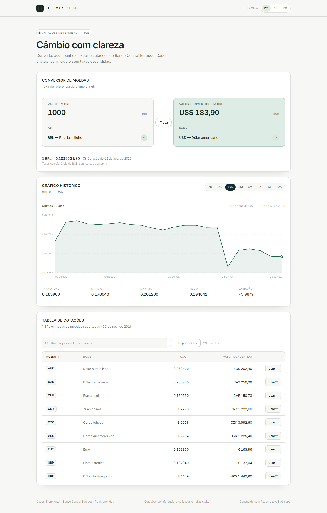
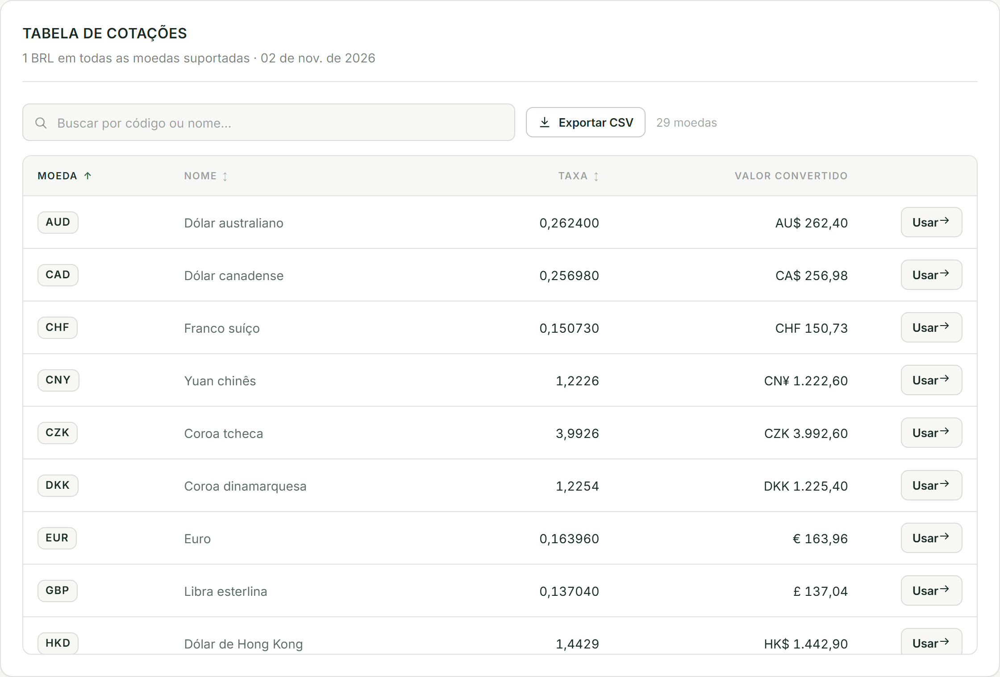

# Evidências de código

Trechos reais do projeto, organizados pelos tópicos do trabalho. Todos os
arquivos estão em `src/`. Capturas em `docs/evidence/`.

---

## 1. Componente funcional + JSX + props

`src/components/ui/Card.jsx` — casca reutilizada pelos três cartões. Recebe
título, subtítulo, ações e conteúdo, e liga o título à seção por
`aria-labelledby`.

```jsx
export default function Card({ id, titleId, title, subtitle, actions, className, bodyClassName, children }) {
  return (
    <section id={id} className={cx(styles.card, className)} aria-labelledby={titleId}>
      <header className={styles.header}>
        <div className={styles.heading}>
          <h2 id={titleId} className={styles.title}>{title}</h2>
          {subtitle ? <p className={styles.subtitle}>{subtitle}</p> : null}
        </div>
        {actions ? <div className={styles.actions}>{actions}</div> : null}
      </header>
      <div className={cx(styles.body, bodyClassName)}>{children}</div>
    </section>
  );
}
```

Validação de props (`RateChart.jsx`):

```js
RateChart.propTypes = {
  points: PropTypes.arrayOf(
    PropTypes.shape({
      date: PropTypes.string.isRequired,
      rate: PropTypes.number.isRequired,
    }),
  ).isRequired,
  fromCode: PropTypes.string.isRequired,
  toCode: PropTypes.string.isRequired,
};
```

---

## 2. Lifting State Up

`src/App.jsx:22-36` — o `App` guarda valor, par e período. Filhos não têm
estado duplicado: recebem valor + callback e devolvem eventos.

```jsx
export default function App() {
  const { t, locale, setLocale, formatters, locales } = useI18n();

  // Estado compartilhado (Lifting State Up): o App é a única fonte de verdade do
  // valor, do par de moedas e do período. Conversor, gráfico e tabela recebem
  // esses dados por props e devolvem eventos.
  const [amountRaw, setAmountRaw] = useState('1000');
  const [fromCode, setFromCode] = useState('BRL');
  const [toCode, setToCode] = useState('USD');
  const [periodId, setPeriodId] = useState(DEFAULT_PERIOD_ID);

  const converterRef = useRef(null);
  const period = findPeriod(periodId);

  const currenciesState = useCurrencies();
  const exchange = useExchangeRate(fromCode, toCode);
  const history = useHistoricalRates(fromCode, toCode, period);
```

O valor convertido é **derivado**, não armazenado:

```jsx
const parsedAmount = useMemo(() => parseAmount(amountRaw, locale), [amountRaw, locale]);
const amountError = parsedAmount.errorKey
  ? t(`converter.amountErrors.${parsedAmount.errorKey}`)
  : null;
const convertedValue =
  parsedAmount.value !== null && Number.isFinite(exchange.rate)
    ? parsedAmount.value * exchange.rate
    : null;
```

---

## 3. `useEffect` + custom hook com cancelamento

`src/hooks/useHistoricalRates.js` — efeito que depende de par + dias, cancela a
requisição anterior e expõe `retry` sem recarregar a página.

```js
export function useHistoricalRates(fromCode, toCode, period) {
  const [state, setState] = useState(EMPTY_STATE);
  const [attempt, setAttempt] = useState(0);
  const periodDays = period?.days ?? 0;

  useEffect(() => {
    if (!fromCode || !toCode || fromCode === toCode || !periodDays) {
      setState(EMPTY_STATE);
      return undefined;
    }

    const controller = new AbortController();
    const range = getPeriodRange({ days: periodDays });
    setState({ points: [], range, isLoading: true, error: null });

    getTimeSeries({
      from: fromCode, to: toCode,
      start: range.start, end: range.end,
      signal: controller.signal,
    })
      .then((result) => setState({ points: result.points, range, isLoading: false, error: null }))
      .catch((error) => {
        if (isAbortError(error)) return;
        setState({ points: [], range, isLoading: false, error });
      });

    return () => controller.abort();
  }, [fromCode, toCode, periodDays, attempt]);

  const retry = useCallback(() => setAttempt((value) => value + 1), []);
  return { ...state, retry };
}
```

Outros efeitos com limpeza:

- `useDebouncedValue` — `clearTimeout` no retorno.
- `useToast` — timer de auto-dismiss cancelado ao desmontar/trocar.
- `useElementWidth` — `ResizeObserver.disconnect()`.
- `I18nProvider` — atualiza `<html lang>` e persiste o idioma.

---

## 4. `fetch` + `async/await` + erros normalizados

`src/services/http.js` — nenhum componente conhece `fetch`.

```js
export class ApiError extends Error {
  constructor(message, { type = 'unknown', status = null, cause } = {}) {
    super(message, { cause });
    this.name = 'ApiError';
    this.type = type;     // 'network' | 'http' | 'invalid' | 'timeout'
    this.status = status;
  }
}

export async function fetchJson(url, { signal, timeoutMs = 12_000 } = {}) {
  const controller = new AbortController();
  const timeoutId = setTimeout(() => {
    controller.abort(new DOMException('Tempo de requisição esgotado', 'TimeoutError'));
  }, timeoutMs);

  try {
    const response = await fetch(url, {
      signal: controller.signal,
      headers: { Accept: 'application/json' },
    });

    if (!response.ok) {
      throw new ApiError(`Falha HTTP ${response.status}`, { type: 'http', status: response.status });
    }

    let data;
    try {
      data = await response.json();
    } catch (error) {
      throw new ApiError('A resposta não é um JSON válido', { type: 'invalid', cause: error });
    }

    if (data === null || typeof data !== 'object') {
      throw new ApiError('Resposta inesperada do serviço de câmbio', { type: 'invalid' });
    }

    return data;
  } catch (error) {
    if (error instanceof ApiError) throw error;
    if (isAbortError(error)) throw error;
    throw new ApiError('Não foi possível contatar o serviço de câmbio', {
      type: 'network', cause: error,
    });
  } finally {
    clearTimeout(timeoutId);
    signal?.removeEventListener('abort', forwardAbort);
  }
}
```

`src/services/frankfurterApi.js` — valida o contrato e normaliza a série:

```js
export async function getTimeSeries({ from, to, start, end, signal }) {
  if (!from || !to || !start || !end) {
    throw new ApiError('Parâmetros insuficientes para a série histórica', { type: 'invalid' });
  }

  const data = await fetchJson(
    buildUrl(`/${start}..${end}`, { base: from, symbols: to }),
    { signal },
  );
  const rates = assertRates(data);

  const points = Object.entries(rates)
    .map(([date, dayRates]) => ({ date, rate: dayRates?.[to] }))
    .filter((point) => Number.isFinite(point.rate) && point.rate > 0)
    .sort((a, b) => a.date.localeCompare(b.date));

  return {
    startDate: typeof data.start_date === 'string' ? data.start_date : start,
    endDate: typeof data.end_date === 'string' ? data.end_date : end,
    points,
  };
}
```

---

## 5. Objeto → array + tabela derivada

`src/App.jsx:47-64` — o mapa `{ USD: 0.1839, EUR: 0.1587, … }` vira linhas
prontas para a tabela, sem estado paralelo.

```jsx
const nameByCode = useMemo(
  () => new Map(currenciesState.currencies.map((currency) => [currency.code, currency.name])),
  [currenciesState.currencies],
);

// Manipulação de objeto → array: o mapa { USD: 0.187 } vira linhas de tabela.
const tableRows = useMemo(() => {
  if (!exchange.rates) return [];

  return Object.entries(exchange.rates)
    .filter(([code, rate]) => code !== fromCode && Number.isFinite(rate) && rate > 0)
    .map(([code, rate]) => ({
      code,
      name: nameByCode.get(code) ?? code,
      rate,
    }))
    .sort((a, b) => a.code.localeCompare(b.code));
}, [exchange.rates, fromCode, nameByCode]);
```

---

## 6. Busca sem acento + ordenação

`src/components/rates/RatesCard.jsx:14-61`:

```js
function normalize(value) {
  return value
    .normalize('NFD')
    .replace(/[\u0300-\u036f]/g, '')
    .toLowerCase()
    .trim();
}

const visibleRows = useMemo(() => {
  const term = normalize(debouncedQuery);

  const filtered = term
    ? rows.filter((row) => {
        const name = formatters.currencyName(row.code, row.name);
        return normalize(`${row.code} ${row.name} ${name}`).includes(term);
      })
    : rows;

  const factor = sort.direction === 'asc' ? 1 : -1;

  return [...filtered].sort((a, b) => {
    if (sort.key === 'rate') return (a.rate - b.rate) * factor;
    if (sort.key === 'name') {
      return formatters.currencyName(a.code, a.name).localeCompare(
        formatters.currencyName(b.code, b.name),
        locale,
      ) * factor;
    }
    return a.code.localeCompare(b.code) * factor;
  });
}, [rows, debouncedQuery, sort, formatters, locale]);
```

O array original (`rows`) nunca é mutado: `[...filtered].sort(...)`.

---

## 7. Gráfico em SVG puro

`src/components/chart/RateChart.jsx` — escala calculada a partir da largura
real do container, eixo Y com "respiro" para a linha não colar nas bordas:

```jsx
const [containerRef, width] = useElementWidth(760);
const height = width < 560 ? 230 : 300;
const plotWidth = Math.max(width - PADDING.left - PADDING.right, 40);
const plotHeight = height - PADDING.top - PADDING.bottom;

const rates = points.map((point) => point.rate);
const rawMin = Math.min(...rates);
const rawMax = Math.max(...rates);
const span = rawMax - rawMin;
const breathing = span === 0 ? Math.abs(rawMax) * 0.01 || 0.0001 : span * 0.12;
const min = rawMin - breathing;
const max = rawMax + breathing;

const scaleX = (index) =>
  points.length === 1
    ? PADDING.left + plotWidth / 2
    : PADDING.left + (index / (points.length - 1)) * plotWidth;
const scaleY = (rate) =>
  PADDING.top + (1 - (rate - min) / (max - min)) * plotHeight;

const linePath = buildPath(points, scaleX, scaleY);
```

Interação por ponteiro e teclado:

```jsx
function handlePointerMove(event) {
  const bounds = event.currentTarget.getBoundingClientRect();
  const relative = event.clientX - bounds.left;
  const ratio = Math.min(Math.max((relative - PADDING.left) / plotWidth, 0), 1);
  setActiveIndex(Math.round(ratio * (points.length - 1)));
}

function handleKeyDown(event) {
  const last = points.length - 1;
  const current = safeIndex ?? last;

  if (event.key === 'ArrowLeft') { event.preventDefault(); setActiveIndex(Math.max(current - 1, 0)); }
  else if (event.key === 'ArrowRight') { event.preventDefault(); setActiveIndex(Math.min(current + 1, last)); }
  else if (event.key === 'Home') { event.preventDefault(); setActiveIndex(0); }
  else if (event.key === 'End') { event.preventDefault(); setActiveIndex(last); }
}
```

```jsx
<svg
  role="img"
  aria-label={summaryLabel}
  aria-describedby={hintId}
  tabIndex={0}
  onKeyDown={handleKeyDown}
  onFocus={() => setActiveIndex((value) => value ?? points.length - 1)}
  onBlur={() => setActiveIndex(null)}
  onPointerMove={handlePointerMove}
  onPointerLeave={() => setActiveIndex(null)}
>
```

Resumo do período (`utils/series.js`):

```js
const average = rates.reduce((total, rate) => total + rate, 0) / rates.length;

return {
  first,
  last,
  min,
  max,
  average,
  variation: first > 0 ? ((last - first) / first) * 100 : 0,
  count: points.length,
  startDate: points[0].date,
  endDate: points[points.length - 1].date,
};
```

---

## 8. CSV sem biblioteca

`src/utils/csv.js`:

```js
const DELIMITER = ';';
const LINE_BREAK = '\r\n';
const BOM = '\uFEFF';

function escapeCell(value) {
  const text = value === null || value === undefined ? '' : String(value);
  // RFC 4180: aspas duplicadas e campo entre aspas quando há separador, quebra ou aspas.
  return /["\n\r;]/.test(text) ? `"${text.replace(/"/g, '""')}"` : text;
}

export function toCsv(columns, rows) {
  const header = columns.map((column) => escapeCell(column.label)).join(DELIMITER);
  const lines = rows.map((row) =>
    columns.map((column) => escapeCell(column.value(row))).join(DELIMITER),
  );
  return `${BOM}${header}${LINE_BREAK}${lines.join(LINE_BREAK)}${LINE_BREAK}`;
}

export function downloadCsv(filename, content) {
  const blob = new Blob([content], { type: 'text/csv;charset=utf-8;' });
  const url = URL.createObjectURL(blob);
  const link = document.createElement('a');

  link.href = url;
  link.download = filename;
  link.rel = 'noopener';
  document.body.appendChild(link);
  link.click();
  link.remove();

  window.setTimeout(() => URL.revokeObjectURL(url), 1_000);
}
```

Uso em `App.jsx` — as linhas exportadas são exatamente as visíveis:

```jsx
onExport={() => onExport(visibleRows)}   // RatesCard.jsx
```

```jsx
const columns = [
  { label: t('csv.headers.date'), value: () => exchange.date ?? todayIso() },
  { label: t('csv.headers.base'), value: () => fromCode },
  { label: t('csv.headers.target'), value: (row) => row.code },
  { label: t('csv.headers.name'), value: (row) => formatters.currencyName(row.code, row.name) },
  { label: t('csv.headers.rate'), value: (row) => String(row.rate) },
  { label: t('csv.headers.converted'), value: (row) => (amount === null ? '' : (amount * row.rate).toFixed(2)) },
];
```

Arquivo gerado no teste: `hermes-USD-IDR-2026-11-02.csv`, com 29 linhas +
cabeçalho.

---

## 9. Formatação pt-BR com `Intl`

`src/utils/format.js`:

```js
const percent = new Intl.NumberFormat(safe, {
  style: 'percent',
  minimumFractionDigits: 2,
  maximumFractionDigits: 2,
  signDisplay: 'exceptZero',
});

formatRate(value) {
  if (!Number.isFinite(value)) return EMPTY;
  const magnitude = Math.abs(value);
  const digits = magnitude >= 100 ? 2 : magnitude >= 1 ? 4 : 6;
  // 0,183900 USD · 5,4378 BRL · 18.136,00 IDR
  return formatter.format(value);
},

formatDate(isoDate) {
  const date = parseIso(isoDate);
  return date ? longDate.format(date) : EMPTY;   // 02 de nov. de 2026
},
```

Datas são interpretadas em UTC (`T00:00:00Z` + `timeZone: 'UTC'`) para não
deslocar o dia conforme o fuso do usuário.

---

## 10. Validação do valor

`src/utils/validation.js`:

```js
export function parseAmount(rawValue, locale = 'pt-BR') {
  const text = String(rawValue ?? '').trim().replace(/\s/g, '');
  if (!text) return { value: null, errorKey: 'required' };

  const normalized = isLatinCommaLocale(locale)
    ? text.replace(/\./g, '').replace(',', '.')
    : text.replace(/,/g, '');

  if (!/^\d*\.?\d+$/.test(normalized)) return { value: null, errorKey: 'invalid' };

  const value = Number(normalized);
  if (!Number.isFinite(value) || value <= 0) return { value: null, errorKey: 'invalid' };
  if (value > MAX_AMOUNT) return { value: null, errorKey: 'tooLarge' };

  return { value, errorKey: null };
}

export function sanitizeAmountInput(rawValue) {
  return String(rawValue ?? '').replace(/[^\d.,]/g, '').slice(0, 18);
}
```

Ligação com o campo (`Field.jsx` + `ConverterCard.jsx`):

```jsx
<label className={styles.label} htmlFor={id}>{label}</label>
{children({ describedBy, invalid: Boolean(error) })}
{error ? <p id={errorId} className={styles.error} role="alert">{error}</p> : null}

<input
  id="converter-amount"
  aria-invalid={invalid || undefined}
  aria-describedby={describedBy}
  ...
/>
```

---

## 11. Acessibilidade da tabela

`src/components/rates/RatesTable.jsx`:

```jsx
<th
  scope="col"
  aria-sort={
    sort.key === column
      ? sort.direction === 'asc' ? 'ascending' : 'descending'
      : 'none'
  }
>
  <SortButton column={column} label={t(`rates.columns.${column}`)} sort={sort} onSort={onSort} />
</th>
```

```jsx
<tr key={row.code} ...>
  <th scope="row" className={styles.codeCell} data-label={t('rates.columns.code')}>
    <span className={styles.code}>{row.code}</span>
  </th>
  ...
</tr>
```

---

## 12. Estados de carregamento, erro e vazio

`StateBlock` centraliza o visual; cada cartão decide qual mostrar:

```jsx
{error ? (
  <StateBlock variant="error" title={t('errors.title')}
    message={t(errorInfo.key, errorInfo.vars)}
    onRetry={onRetry} retryLabel={t('common.retry')} />
) : isLoading ? (
  <StateBlock variant="loading" title={t('chart.loading')} />
) : chartPoints.length === 0 ? (
  <StateBlock variant="empty" title={t('chart.emptyTitle')} message={t('chart.empty')} />
) : (
  <RateChart ... />
)}
```

Capturas: `docs/evidence/estado-erro.png` e `docs/evidence/estado-vazio.png`.

---

## 13. Capturas

| Arquivo | O que mostra |
| --- | --- |
| `docs/evidence/desktop.png` | Página completa em 1440px |
| `docs/evidence/tablet.png` | Página completa em 834px |
| `docs/evidence/mobile.png` | Página completa em 390px |
| `docs/evidence/converter.png` | Cartão do conversor em 2× |
| `docs/evidence/chart.png` | Cartão do histórico em 2× |
| `docs/evidence/chart-tooltip.png` | Crosshair + tooltip ativos |
| `docs/evidence/rates.png` | Tabela, busca, ordenação e CSV |
| `docs/evidence/estado-vazio.png` | Busca sem resultado |
| `docs/evidence/estado-erro.png` | Falha total da API com retry |
| `docs/evidence/mobile-converter.png` | Conversor empilhado no mobile |
| `docs/evidence/mobile-table-row.png` | Linha da tabela em formato cartão |




---

## 14. Resultados de execução

Build de produção:

```
vite v7.3.7 building client environment for production...
✓ 90 modules transformed.
dist/index.html                 0.98 kB │ gzip:  0.53 kB
dist/assets/index-*.css        24.38 kB │ gzip:  5.63 kB
dist/assets/index-*.js        279.93 kB │ gzip: 88.26 kB
✓ built in 1.07s
```

Consulta real (02/11/2026):

- `GET /v1/latest?base=BRL` → `1 BRL = 0,183900 USD`, cotação de `2026-10-30`.
- Série de 30 dias BRL→USD → 24 pontos úteis, variação `-3,98%` (execução anterior) / `-2,69%` em 7D.
- Tabela com 29 moedas.
- Nenhum erro de console nas execuções finais.

O roteiro completo está em [`QA.md`](QA.md).
